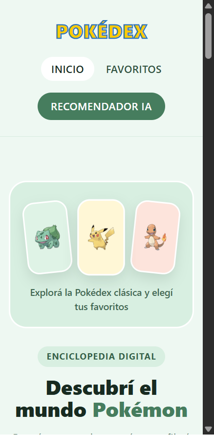
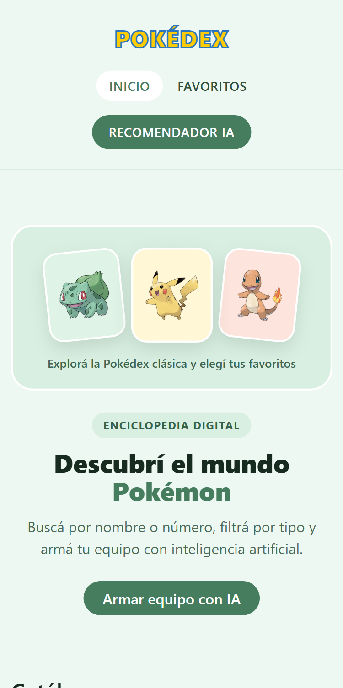

# Pokédex

Aplicación de consulta de Pokémon desarrollada con Vue 3, Vite, Vue Router y Bootstrap.

## Integrantes

- Xiomara Tebes

## Tema y API

Pokédex web para explorar especies de Pokémon, buscar por nombre o número, filtrar por tipo, ver estadísticas y guardar favoritos.
La búsqueda por nombre o número se realiza mediante un filtro sobre los datos previamente cargados desde la API.

- **API utilizada:** [PokéAPI](https://pokeapi.co/) (datos, imágenes, tipos y descripciones en español, no requiere clave).

**Aclaración:** La URL conserva el nombre Astra porque inicialmente el proyecto estaba orientado a una temática relacionada con el universo. Debido a inconvenientes con la API elegida, decidí cambiar la temática a Pokémon y utilizar PokéAPI, manteniendo el proyecto de Firebase creado anteriormente.

## Instalación

```bash
npm install
npm run dev
```

En Windows, si PowerShell bloquea `npm`, usar `npm.cmd`.

## Variables de entorno

Copiar `.env.example` como `.env` y completar:

- `VITE_FIREBASE_API_KEY`, `VITE_FIREBASE_AUTH_DOMAIN`, `VITE_FIREBASE_PROJECT_ID`, `VITE_FIREBASE_APP_ID`: credenciales de la app web en Firebase.
- `VITE_FIREBASE_MODEL`: modelo de Gemini a utilizar (`gemini-3.8-flash`).
- `VITE_RECAPTCHA_SITE_KEY`: clave pública de reCAPTCHA v3 para Firebase App Check.

## Inteligencia artificial

Se utilizó **Firebase AI Logic** (Gemini Developer API con el modelo `gemini-3.8-flash`) protegido con **Firebase App Check** (`ReCaptchaV3Provider`). Recomienda hasta tres Pokémon de la primera generación según las preferencias del usuario.

## Publicación en Firebase

```bash
npm run build
npx firebase-tools login
npx firebase-tools deploy --only hosting --project astra-9efae
```

- **URL pública:** https://astra-9efae.web.app

## Capturas

### Versión escritorio


### Versión móvil



## Créditos

Datos e imágenes: PokéAPI y su repositorio de sprites. Pokémon pertenece a sus respectivos titulares. Proyecto educativo no oficial.
